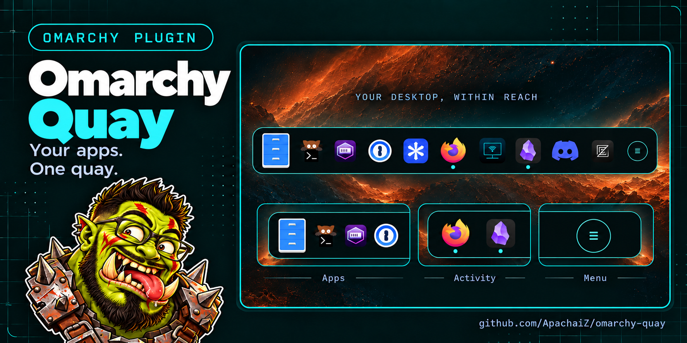

# Quay



[](https://github.com/ApachaiZ/omarchy-dropdown)

A floating app shelf for [Omarchy](https://omarchy.org). Quay is a berth for
the apps you keep close: pinned, searchable, reorderable, and light on the
shell.

- **ALT + SPACE** toggles Quay at the bottom of the screen.
- Hover reveal is optional (default On). Turning it off disables only the
  bottom-edge hover; **ALT + SPACE** and the IPC/CLI toggle always open Quay.
- **Dropdown-aware**: parked Dropdown apps carry the `dropdown-hidden` tag and
  stay out of Quay's running list and window menu. See
  [Dropdown compatibility](#dropdown-compatibility).
- Pinned favorites, persisted in `~/.config/omarchy/quay.json`.
- **Application grid**: the `☰` button opens a COSMIC-style grid of installed
  apps. Choose 3–12 columns, 1–10 visible rows, and whether tile labels are
  shown. Search ranks name, generic-name, comment, keyword, desktop-id and
  acronym matches. A letter or number typed while Quay is open opens the grid
  with the filter already started.
- Icons magnify on hover (1.8× by default). Icon size (32–64 px in 4 px
  steps), hover zoom (1.3×/1.5×/1.8×), icon gap (0–24 px), and
  horizontal/vertical padding are configurable in the Quay preferences. The
  Quay width is computed from the configured size, zoom, gap, and padding,
  so hovering never resizes or shifts the bar.
- Drag an icon along the rail to reorder pinned favorites (persisted). A
  marker shows the drop slot and a ghost follows the pointer; dropping a
  running unpinned app into the rail pins it at that position.
- Click an icon to focus its window, switching to its workspace if needed;
  launch it when it is not running.
- Pin or unpin from the grid: hover a tile and click its star, or right-click
  it. Pinned tiles keep a subtle star badge, and the grid stays open while you
  curate Quay.
- Optional app-name tooltip on hover/keyboard selection (off by default,
  toggled in Quay preferences).
- Configurable arrival/departure animations: slide, bounce, scale, zoom,
  horizontal slide, fade, blur (frosted materialize), stagger (icons
  cascade in), with speed control, plus every sensible combination
  (bounce pairs with fade/blur/stagger/scale/zoom, slide, scale, zoom,
  stagger and horizontal-slide pairs with fade/blur/stagger). The app grid
  and the menus always materialize with their own fixed blur animation,
  independent of the dock animation and speed.
- Full keyboard navigation while Quay is open (see below). On the dock, the
  active icon is shown by the same zoom used for hover; there is no selection
  frame. In the application grid, the keyboard selection has a visible focus
  ring.
- The application grid scrolls with the mouse wheel and keeps Quay open while
  you browse, pin apps or change preferences.

## Dropdown compatibility

Quay and [Dropdown](https://github.com/ApachaiZ/omarchy-dropdown) are built to
work together. Dropdown hides an app by parking its real window on a Hyprland
special workspace and tagging it **`dropdown-hidden`**. Quay reads that tag
from `hyprctl clients -j` and leaves the window out of its running-app list
and its window menu. Revealing, popping out or releasing the app removes the
tag and Quay lists it again.

| Dropdown state | Window tag | Quay |
| --- | --- | --- |
| Visible | — | shown as running |
| Hidden (parked) | `dropdown-hidden` | hidden from the shelf |
| Revealed, released or restored | — | shown again |

- Dropdown **≥ 0.7.9** adds the tag; Quay **≥ 1.0.1** filters it (Quay 1.2.2
  is current).
- No configuration is needed on either side: install one, the other, or both.
- Hyprland has no `skip_taskbar` flag. Any dock or launcher can use the same
  convention by ignoring clients whose `tags` array in
  `hyprctl clients -j` contains `dropdown-hidden`.

## Keyboard

When Quay is summoned (ALT + SPACE), it grabs keyboard focus:

- `←` / `→` (or `↑` / `↓`): move the selection across icons and the `☰`
  grid button.
- `Enter`: launch the selected app, or focus its window if it is running
  (same as a left click).
- `Space`: cycle through the selected app's windows (same as the mouse
  wheel); launches it if it is not running. With the grid open, `Space`
  types a space in the search field.
- `Escape` or `ALT + SPACE`: close. `Escape` closes panels progressively
  (grid/detail → menu → Quay).
- With a menu open (context menu, preferences): `↑` / `↓` move the
  highlighted row, `Enter`/`Space` trigger it, `Escape` goes back.
- Key presses keep Quay open for 10 s after the last press; the
  hover "Hide delay" setting only applies to pointer-driven shows.
- **Type to search:** with Quay open, pressing a letter or number opens the
  application grid and starts filtering immediately. Inside the grid,
  `←` / `→` / `↑` / `↓` move in two dimensions, `Enter` launches the
  highlighted app (or the first match), `Tab` moves focus between the search
  field and the ⚙ settings button, and `Escape` closes the grid. Typing a
  letter while the ⚙ button has focus returns to the search field with that
  character.

## Requirements

- Omarchy (uses the `omarchy-shell` Quickshell framework and its IPC).
- Hyprland (for the layer-shell window and the ALT + SPACE binding).
- Optional: Dropdown ≥ 0.7.9, so parked Dropdown windows are filtered out of
  the shelf (see [Dropdown compatibility](#dropdown-compatibility)).

## Install

```bash
omarchy plugin add https://github.com/ApachaiZ/omarchy-quay.git --enable
omarchy restart shell
```

The repository is a standard Omarchy plugin: `manifest.json` is at the root
and the overlay entry point is `Quay.qml`. It has no install hooks and does
not modify user configuration.

Bind the shortcut once in `~/.config/hypr/bindings.lua`, then reload:

```lua
o.bind("ALT + SPACE", "Basculer Quay", "omarchy-shell shell toggle io.github.apachaiz.quay")
```

```bash
hyprctl reload
```

## Favorites

`~/.config/omarchy/quay.json` is a JSON array of desktop-entry ids:

```json
["firefox.desktop", "foot.desktop", "org.gnome.Nautilus.desktop"]
```

Pin or unpin from the application grid: hover a tile and click its star, or
right-click the tile. Pinned tiles keep a star badge. Reorder the dock by
dragging icons in Quay. The JSON file remains editable for scripted setups.

## Preferences

Right-click the Quay background to open the preferences. The panel is split
into three equal columns (Placement/Behavior, Appearance/App grid, Motion)
with centered section titles and vertical separators. Arrow keys move between
rows and left/right adjust the focused value; Enter cycles it. Icon size,
hover zoom, icon gap, horizontal and vertical padding, animation, hide delay,
**hover reveal**, screen, the name tooltip, and the application grid's
columns, visible rows and tile labels are persisted in
`~/.config/omarchy/quay-settings.json`. The Quay width is derived from the
selected icon size, zoom, gap, and padding; it does not change while an icon
is magnified. Grid columns and rows live under **App grid**; tile labels can be
turned off for a pure icon grid.

**Hover reveal → Off** removes only the bottom-edge pointer reveal. The
**ALT + SPACE** shortcut and `omarchy-shell shell toggle io.github.apachaiz.quay`
still open Quay; the setting is stored as `"showOnHover": false` in the
settings file.

## Uninstall

```bash
omarchy plugin remove io.github.apachaiz.quay
```

Remove the `ALT + SPACE` line from `bindings.lua` and run `hyprctl reload`.

## Files

```
manifest.json   # plugin registration (overlay, keepLoaded)
Quay.qml        # overlay window, dock, menus, prefs, drag & drop
AppGrid.qml     # searchable COSMIC-style application grid
PanelBlurEffect.qml # independent blur materialize for sub-panels
MenuRow.qml     # row used by the menus
Model.js        # favorites, search ranking, Exec parsing, desktop entries
tests/          # Node unit tests for Model.js
preview.png     # marketplace / README hero
LICENSE
```

## Runtime and safety

- Favorites and settings are written directly through `FileView`; no shell
  process is spawned to persist state.
- App launches and Hyprland dispatches pass an argv vector, so desktop-entry
  fields are never interpolated into a shell command.
- Application search runs in-process against the Quickshell desktop-entry
  database. It spawns no helper process and makes no network request.
- Running apps are refreshed by one `hyprctl clients -j` poll every two
  seconds **only while Quay is visible or interactive**; the entry model is
  rebuilt only when an entry actually changes. Hidden Quay spawns no poll.
- No network access and no elevated privileges.
- The blur effect and its offscreen layer are only instantiated when the blur
  animation is selected and Quay is visible.

## Notes

- Quay floats over windows (no space reserved); it is not an autohiding
  persistent bar, it appears on demand.
- Default favorites are `firefox`, `foot`, and `org.gnome.Nautilus`; they are
  written on first run and dropped if not installed.
- `Model.js` is plain JavaScript: run its tests with
  `node tests/model.test.js`.

## License

MIT.
