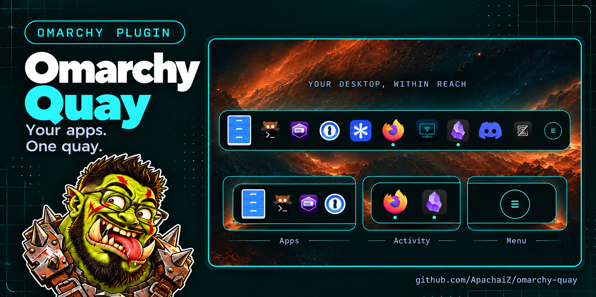

# Quay



A floating app shelf for [Omarchy](https://omarchy.org), in the spirit of GNOME's
Dash to Dock / the macOS Dock. Quay is a berth for the apps you keep close:
pinned, searchable, reorderable, and light on the shell.

- **ALT + SPACE** toggles Quay at the bottom of the screen.
- Pinned favorites, persisted in `~/.config/omarchy/quay.json`.
- Icons magnify on hover (1.8× by default). Icon size (32–64 px in 4 px
  steps), hover zoom (1.3×/1.5×/1.8×), icon gap (0–24 px), and
  horizontal/vertical padding are configurable in the Quay preferences. The
  Quay width is computed from the configured size, zoom, gap, and padding,
  so hovering never resizes or shifts the bar.
- Drag an icon along the rail to reorder pinned favorites (persisted). A
  marker shows the drop slot and a ghost follows the pointer; dropping a
  running unpinned app into the rail pins it at that position.
- Click an icon to focus its window, switching to its workspace if needed;
  launch it when it is not running.
- Pin or unpin from the app picker: pinned rows show a check, and the picker
  stays open while you curate Quay.
- Optional app-name tooltip on hover/keyboard selection (off by default,
  toggled in Quay preferences).
- Configurable arrival/departure animations: slide, bounce, scale, zoom,
  horizontal slide, fade, blur (frosted materialize), stagger (icons
  cascade in), with speed control, plus every sensible combination
  (bounce pairs with fade/blur/stagger/scale/zoom, slide, scale, zoom,
  stagger and horizontal-slide pairs with fade/blur/stagger).
- Full keyboard navigation while Quay is open (see below). The active
  icon is shown by the same zoom used for hover; there is no selection frame.
- The app picker scrolls with the mouse wheel and keeps Quay open while
  you browse or change preferences.

## Keyboard

When Quay is summoned (ALT + SPACE), it grabs keyboard focus:

- `←` / `→` (or `↑` / `↓`): move the selection across icons and the `☰`
  app-picker button.
- `Enter`: launch the selected app, or focus its window if it is running
  (same as a left click).
- `Space`: cycle through the selected app's windows (same as the mouse
  wheel); launches it if it is not running.
- `Escape` or `ALT + SPACE`: close. `Escape` closes panels progressively
  (picker/detail → menu → Quay).
- With a menu open (context menu, preferences): `↑` / `↓` move the
  highlighted row, `Enter`/`Space` trigger it, `Escape` goes back.
- Key presses keep Quay open for 10 s after the last press; the
  hover "Hide delay" setting only applies to pointer-driven shows.
- In the app picker, type to search; `↑` / `↓` highlight a result, `Enter`
  launches it (or the first match), `Tab` moves focus to the ⚙ settings
  button and back, `Escape` closes.

## Requirements

- Omarchy (uses the `omarchy-shell` Quickshell framework and its IPC).
- Hyprland (for the layer-shell window and the ALT + SPACE binding).

## Install

```bash
omarchy plugin add https://github.com/ApachaiZ/omarchy-quay.git --enable
omarchy restart shell
```

The repository is a standard Omarchy plugin: `manifest.json` is at the root
and the overlay entry point is `Quay.qml`. It has no install hooks and does
not modify user configuration.

Bind the shortcut once in `~/.config/hypr/bindings.lua`, then reload:

```lua
o.bind("ALT + SPACE", "Basculer Quay", "omarchy-shell shell toggle io.github.apachaiz.quay")
```

```bash
hyprctl reload
```

## Favorites

`~/.config/omarchy/quay.json` is a JSON array of desktop-entry ids:

```json
["firefox.desktop", "foot.desktop", "org.gnome.Nautilus.desktop"]
```

Pin or unpin from the app picker’s row button; pinned apps show a check.
Reorder by dragging icons in Quay. The JSON file remains editable for
scripted setups.

## Preferences

Right-click the Quay background to open the preferences. The panel is split
into three equal columns (Placement, Appearance, Motion) with centered
section titles and vertical separators. Arrow keys move between rows and
left/right adjust the focused value; Enter cycles it. Icon size, hover zoom,
icon gap, horizontal and vertical padding, animation, hide delay, screen, and
the name tooltip are persisted in `~/.config/omarchy/quay-settings.json`. The
Quay width is derived from the selected icon size, zoom, gap, and padding; it
does not change while an icon is magnified.

## Uninstall

```bash
omarchy plugin remove io.github.apachaiz.quay
```

Remove the `ALT + SPACE` line from `bindings.lua` and run `hyprctl reload`.

## Files

```
manifest.json   # plugin registration (overlay, keepLoaded)
Quay.qml        # overlay window, magnification, drag & drop
MenuRow.qml     # row used by the menus
Model.js        # favorites persistence, Exec parsing, desktop-entry resolution
preview.png     # marketplace / README hero
LICENSE
```

## Runtime and safety

- Favorites and settings are written directly through `FileView`; no shell
  process is spawned to persist state.
- App launches and Hyprland dispatches pass an argv vector, so desktop-entry
  fields are never interpolated into a shell command.
- Running apps are refreshed by one `hyprctl clients -j` poll every two
  seconds **only while Quay is visible or interactive**; the entry model is
  rebuilt only when an entry actually changes. Hidden Quay spawns no poll.
- No network access and no elevated privileges.
- The blur effect and its offscreen layer are only instantiated when the blur
  animation is selected and Quay is visible.

## Dropdown interoperability

[Dropdown](https://github.com/ApachaiZ/omarchy-dropdown) ≥ 0.7.9 parks hidden
application windows on a special workspace and tags them
`dropdown-hidden` in Hyprland. Quay skips clients carrying that tag when it
builds its running-app list, so a hidden Dropdown app does not appear as
running in the shelf and is not offered in its window list.

The tag is removed as soon as Dropdown reveals or releases the window, so the
app shows up normally again. No configuration is needed on either side.

Hyprland has no `skip_taskbar` flag; other docks can use the same convention
by ignoring entries whose `tags` array in `hyprctl clients -j` contains
`dropdown-hidden`.

## Notes

- Quay floats over windows (no space reserved); it is not an autohiding
  persistent bar, it appears on demand.
- Default favorites are `firefox`, `foot`, and `org.gnome.Nautilus`; they are
  written on first run and dropped if not installed.

## License

MIT.
